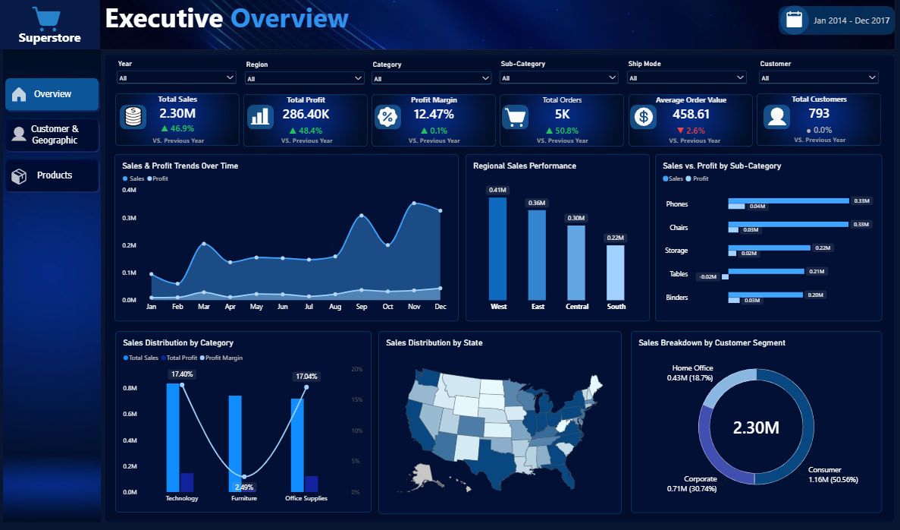
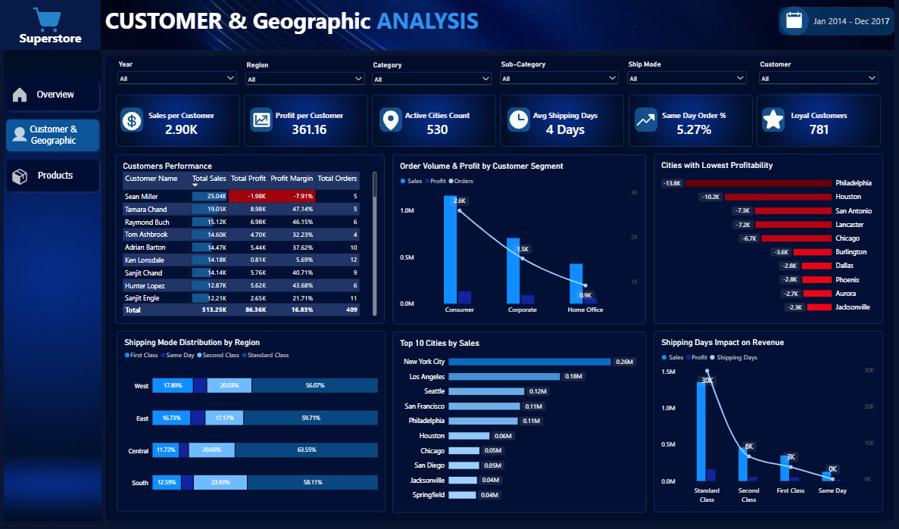
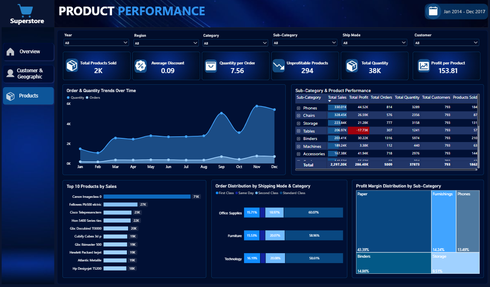

#  Superstore Power BI Executive Dashboard

An interactive Power BI Business Intelligence Dashboard built to analyze sales, profitability, customer behavior, geographic performance, shipping operations, and product performance using the Superstore dataset.

The project combines advanced data cleaning, Power Query ETL transformations, a robust Star Schema data model, DAX measures, and executive-level data visualization into one complete professional analytical solution.

The final project consists of **three interactive pages** covering high-level executive insights, customer and geographic dynamics, and deep-dive product performance.

---

## 📈 Dashboards

### 1. Executive Overview

Provides a high-level overview of overall business performance through:

- Total Sales, Profit & Profit Margin (with YoY growth indicators)
- Total Orders, Average Order Value & Total Customers
- Sales & Profit Trends
- Regional Sales Performance
- Sales & Profit Variance by Sub-Category
- Sales Distribution by Category
- Sales Distribution by State 
- Sales Breakdown by Customer Segment

**Interactive Filters:**
- Year
- Region
- Category
- Sub-Category
- Ship Mode
- Customer

### 2. Customer & Geographic Analysis

Focuses on customer behavior, customer profitability, geographic locations, and shipping logistics.

- Sales per Customer & Profit per Customer
- Active Cities Count & Average Shipping Days
- Same Day Order % & Loyal Customers
- Customers Performance Matrix 
- Order Volume & Profit by Customer Segment
- Cities with Lowest Profitability
- Shipping Mode Distribution by Region
- Top 10 Cities by Sales
- Shipping Days Impact on Revenue

**Interactive Filters:**
- Year
- Region
- Category
- Sub-Category
- Ship Mode
- Customer

### 3. Product Performance

Focuses on product analytics, profitability margins, and detailed granular item performance.

- Total Products Sold, Average Discount & Quantity per Order
- Unprofitable Products, Total Quantity & Profit per Product
- Order & Quantity Trends Over Time
- Sub-Category & Product Performance Matrix (with drill-down capabilities)
- Top 10 Products by Sales
- Order Distribution by Shipping Mode & Category
- Profit Margin Distribution by Sub-Category

**Interactive Filters:**
- Year
- Region
- Category
- Sub-Category
- Ship Mode
- Customer

---

## 🧹 Data Preparation & Transformation

Using **Power Query**, the raw Superstore dataset was thoroughly prepared through:

- Data type validation and schema optimization
- Removing duplicates and handling missing values
- Text cleaning, standardization, and column transformations
- Profiling data and creating calculated/derived conditional columns
- Structuring tables to establish a robust relational data model

---

## ⭐ Data Modeling & Star Schema

The project was structured using a **Star Schema** to optimize query performance and scalability.

### 🟦 Fact Table

**`Fact_Orders`**: The central transactional table containing order-line level business data.

**Columns:**
`Row ID`, `Order ID`, `Order Date`, `Ship Date`, `Customer ID`, `Product ID`, `Postal Code`, `Ship Mode ID`, `Sales`, `Quantity`, `Discount`, `Profit`, and `Shipping Days`.

### 🟩 Dimension Tables

| Table | Description | Columns |
|---|---|---|
| `Dim_Customers` | Customer-related descriptive information | Customer ID, Customer Name, Segment |
| `Dim_Products` | Product-related details | Product ID, Product Name, Category, Sub-Category |
| `Dim_Location` | Geographic information | Country, Region, State, City, Postal Code |
| `Dim_ShipMode` | Shipping method classifications | Ship Mode ID, Ship Mode |
| `Dim_Date` | A dedicated date dimension used for time-based calculations and trends | Date, Month, Month Name, Quarter, Year |
| `Measures_Table` | A centralized dedicated table storing all complex DAX measures | — |

### 🔗 Data Model Architecture & Relationships

The model implements a clean **one-to-many relationship structure**, where each dimension filters the central Fact table.

```text
                         ┌──────────────┐
                         │   Dim_Date   │
                         └──────┬───────┘
                                │
                                ▼
┌──────────────┐         ┌──────────────┐         ┌──────────────┐
│ Dim_Customers│───────▶ │  Fact_Orders │ ◀───────│ Dim_Products │
└──────────────┘         └──────┬───────┘         └──────────────┘
                                │
                    ┌───────────┴───────────┐
                    │                       │
                    ▼                       ▼
             ┌──────────────┐        ┌──────────────┐
             │ Dim_Location │        │ Dim_ShipMode │
             └──────────────┘        └──────────────┘
```

---

## 🛠️ Tools & Skills

- **Power BI Desktop:** UI/UX Dark Theme Design, Custom Navigation, Tooltips, Advanced Formatting
- **Power Query (ETL):** Data Cleaning, Transformations, Merging, Appending
- **Data Modeling:** Star Schema, Fact & Dimension Tables, One-to-Many Relationships
- **DAX (Data Analysis Expressions):** Custom Measures, KPI Calculations, Dynamic Formatting, Conditional Color Measures
- **Data Analysis:** Exploratory Data Analysis, Trend Analysis, Customer Segmentation, Regional & Geographic Performance, Profitability Optimization

---

## 📁 Project Structure

```text
Superstore-PowerBI-Executive-Dashboard/
│
├── Superstore_Dashboard.pbix
├── README.md
│
└── Images/
    ├── Executive-Overview.png
    ├── Customer-Geographic-Analysis.png
    └── Product-Performance.png
```

---

## 📸 Dashboard Preview

### Executive Overview



### Customer & Geographic Analysis



### Product Performance



